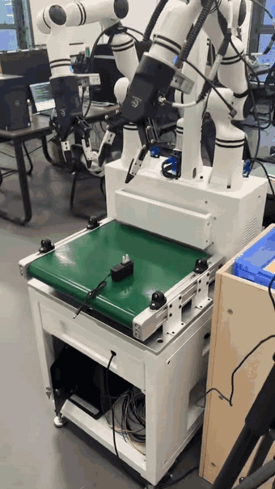
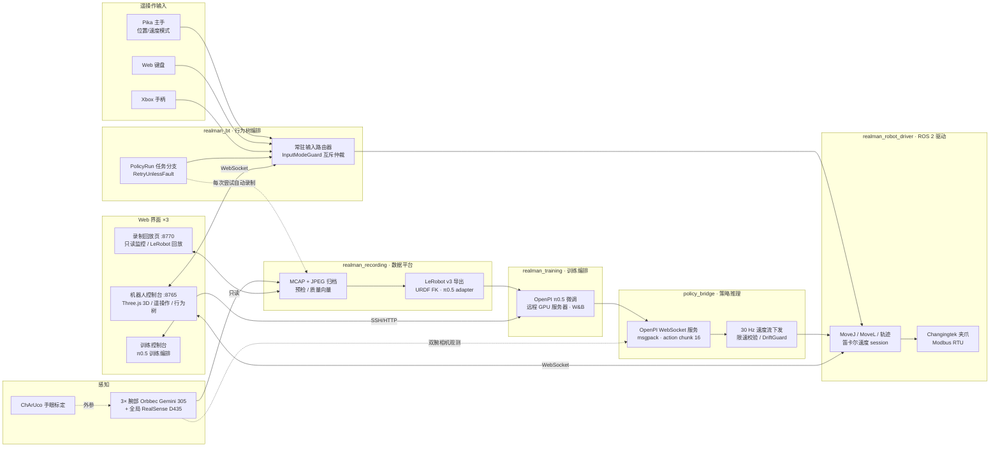
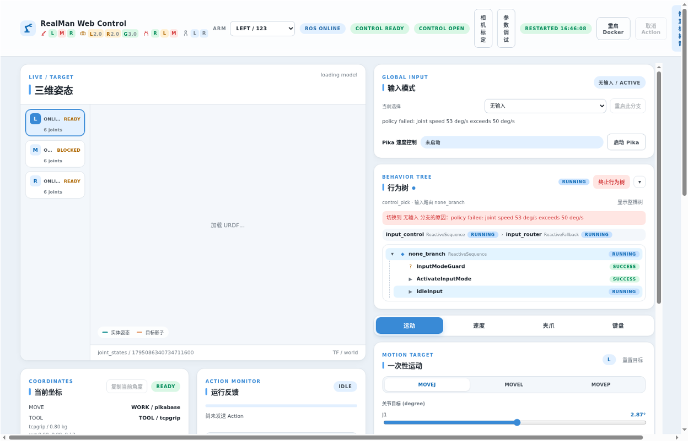
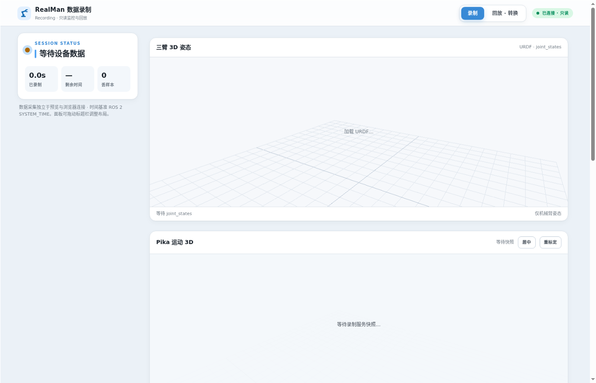
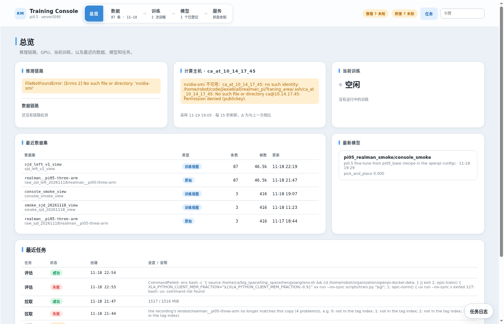

# RealMan 三机械臂 VLA 智能作业平台

**ROS 2 Humble · π0.5 VLA · BehaviorTree.CPP · WebSocket · 全 Docker 化**

面向三台 RealMan RM65 协作机械臂（左 `l`、中 `m`、右 `r`）的具身智能作业平台，端到端打通
**Pika 主手遥操作采集 → 数据录制 → LeRobot 数据集导出 → π0.5 训练 → 策略推理 → 机械臂自主执行** 的完整闭环，
并配套三个自研 Web 界面（机器人控制台 / 数据录制回放 / 训练编排）。
当前已在双臂（左/右）上完成任务级验证：π0.5 策略驱动机械臂自主抓取电源适配器并放入蓝色收纳箱。

## 效果演示

**π0.5 策略自主抓取（实拍，3× 速放）**——无人工干预，模型观测双腕相机 + 关节状态，输出动作块驱动机械臂完成抓取：



> 任务指令：*pick up the power adapter and put it in the blue bin*。策略执行前由行为树自动将机械臂 MoveJ 到数据采集同一起点位姿，保证训练/部署分布一致。

## 项目亮点

- **全流程闭环**：从人手遥操作采数到 VLA 策略驱动机械臂自主执行，一条链路贯通，行为树在每次策略尝试时自动录制 session，形成数据飞轮。
- **多源遥操作统一仲裁**：Pika 主手（位置/速度模式）、Web 键盘、Xbox 手柄、Web 控制台四种控制权由 BehaviorTree.CPP 行为树互斥路由，任一时刻只有一种输入源可驱动机械臂。
- **三个自研 Web 界面**：TypeScript + Three.js/urdf-loader 的机器人控制台（三臂 3D 影子 + 运动控制 + 行为树监视 + 参数热调）、只读数据录制回放页、远程训练编排控制台，全部 WebSocket 实时通信。
- **严格的数据契约**：录制平台只订阅驱动输出（不发布任何运动命令），LeRobot v3 导出用 URDF 正运动学派生末端位姿，π0.5 adapter 显式声明 state/action 维度契约。
- **工程化策略部署**：动作块（horizon 16）滚动下发、30 Hz 速度流、安全限速 + 零漂守卫、断线指数退避、连续失败自动暂停，推理指标全部实测并写入配置注释。
- **可复现工程**：全组件 Docker 化，权威配置单份化（根 `config/`），185 个测试文件 + CI，配套 VitePress 文档站。

## 系统架构



## 全流程闭环

| 环节 | 模块 | 关键实现 |
| --- | --- | --- |
| 遥操作采集 | `realman_bt` + `realman_pika_session` | Pika 主手位置/速度模式映射到臂末端；Web 键盘与 Xbox 手柄经同一行为树路由 |
| 任务编排 | `realman_bt` | 常驻输入路由器 + `PolicyRun` 任务分支：先 MoveJ 至采集同起点，再执行抓取-放置（夹爪开合、放置完成判定），`RetryUnlessFault` 区分可重试失败与不可恢复故障 |
| 数据录制 | `realman_recording` | 只订阅驱动输出；MCAP/JPEG 双轨归档、设备与磁盘预检、有界队列 + 质量向量、时间戳 gap 拒绝 |
| 数据集导出 | `realman_recording` | 异步导出 LeRobot v3（`lerobot==0.4.4` 固定版本）；URDF FK 派生末端位姿；`adapters/pi05.py` 显式 state/action 维度契约 |
| 策略训练 | `realman_training` | OpenPI π0.5 远程训练控制台：register → norm stats → train → eval → serve 全 steps 编排，Docker compose 驱动远程 GPU 服务器，日志/W&B 跟踪 |
| 策略推理 | `policy_bridge` | 纯协议桥（OpenPI WebsocketPolicyServer 协议，msgpack）：双腕相机 224×224 + 7 维 state 观测；action chunk 16 步、每次取 5 步、余 4 步提前推理、30 Hz 滚动发布 |
| 自主执行 | `policy_bridge` → 驱动 | 归一化动作 → SI 单位限速映射 + 一阶低通平滑 → 笛卡尔速度 session；watchdog 100 ms |
| 数据飞轮 | 行为树 × 录制 | 每次策略尝试经 `/recording/attempt` 自动录制 session，失败案例直接回流训练集 |

## Web 界面（三套自研前端）

### 1. 机器人控制台（`realman_web_control`，`:8765`）

TypeScript + Vite + Three.js/urdf-loader 前端，aiohttp WebSocket 服务端（origin 校验、心跳、客户端上限）。单页集成机器人运维的全部高频操作：



- **三臂 3D 实时视图**：URDF 渲染实体姿态与运动目标「影子」，逐臂在线状态卡（ONLINE / BLOCKED）与 6 关节角度实时显示，支持实时/目标视图切换
- **运动控制**：MoveJ / MoveL / MoveP 一次性运动（关节滑条 + IK 目标）、笛卡尔速度连续控制、坐标系切换（MVP / TCP / WORK / TOOL）
- **键盘遥操作**：网页端速度遥操作，与 Pika / 策略输入经行为树互斥仲裁
- **行为树面板**：树形节点可视化（ReactiveSequence / ReactiveFallback / InputModeGuard …），节点级 SUCCESS / RUNNING 状态标签、错误提示条、一键终止
- **Pika 遥操作入口**：输入模式选择 + 一键启动 Pika 速度控制
- **夹爪控制**：Changingtek 夹爪行程实时显示（L2.0 / R2.0 / G3.0）与开合控制
- **运维面板**：Action Monitor 运行反馈、相机手眼标定入口、运行时参数热调（apply / revert / baseline / history / export）、Docker 重启、急停取消

### 2. 数据录制 / 回放页（`realman_recording`，`:8770`）

严格只读设计——Web 页面不提供开始/停止按钮，录制由 ROS 2 侧/行为树触发，杜绝「浏览器误触发运动或录制」：



- **Session 监控**：已录时长、剩余时间、丢样本计数（时间基准为 ROS 2 `SYSTEM_TIME`，数据丢弃独立于浏览器延迟）
- **三臂 3D 姿态回放**：`joint_states` 实时驱动 URDF
- **Pika 运动 3D 快照**：遥操作轨迹空间可视化（等待快照 / 重拍 / 重新定）
- **LeRobot 数据集回放 / 格式转换**页签

### 3. 训练控制台（`realman_training`）

π0.5 微调的远程编排界面，在浏览器里驱动 GPU 服务器完成整条训练流水线：



- **总览仪表盘**：计算主机、当前训练任务（模型 / steps / GPU）、最近任务（评估、模型拉取及速率）、任务日志、物理终端
- **数据集管理**：LeRobot 数据集（`realman_pi05-three-arm`，已采 87 条演示轨迹 / 约 46.5k 帧）与训练视图（左/右臂 action-only）管理
- **模型管理**：`pi05` fine-tune from `pi05_base` checkpoint 追踪、评估结果、模型拉取
- **训练编排**：norm stats → train → eval → pull → serve 全流程一键下发，远程 Docker compose 执行，W&B 曲线跟踪

## Pika 主手遥操作

Pika 手持主手设备是人类示教采集的核心入口，也是数据集质量的第一保证：

- **位置模式（pikaposition）**：主手位姿直接映射机械臂末端位姿，所见即所得的示教方式
- **速度模式（pikavelocity）**：主手位移映射为笛卡尔速度，长时间作业不易疲劳，更安全
- **会话管理（`realman_pika_session`）**：设备连接、模式切换、使能状态机由独立会话节点管理，行为树分支（`config/behavior-trees/control.xml`）声明式定义 pikaposition / pikavelocity 两条互斥分支
- **接入即受仲裁**：Pika 与键盘、Xbox、策略共享同一条输入路由行为树，`InputModeGuard` 保证控制权互斥；中臂对 Pika 永久跳过（`skip: true`）
- **可视化闭环**：Web 控制台一键启动、录制页提供 Pika 运动 3D 快照用于核查示教轨迹质量

## 行为树编排（BehaviorTree.CPP）

平台的「中枢神经」，解决多输入源并发冲突与任务流程编排两大问题：

- **常驻输入路由器（`control.xml`）**：ReactiveFallback + `InputModeGuard` 仲裁五种控制权（web / 键盘 / Pika 位置 / Pika 速度 / 策略），高优先级输入可抢占，切换过程不产生双驱动
- **`PolicyRun` 任务分支**：MoveJ 至采集同起点 → 策略推理执行 pick-and-place → 夹爪开合与 release-over-the-bin 完成判定 → 每次尝试自动录制 session
- **失败分级**：`RetryUnlessFault` 区分可重试失败（空抓 / 超时 / 堵转）与不可重试故障（越界 / 丢数据），前者重试并沉淀数据，后者安全停机
- **只读监视器**：`:8080` 树节点级状态监视，与 Web 控制台行为树面板互补
- **无硬件开发**：`realman_bt_mock` 提供仿真后端，行为树逻辑可离线回归

## 其余核心模块

- **驱动与运动（`src/driver/`）**：RealMan Python SDK 三臂驱动——可取消的 MoveJ / MoveL / 连续轨迹，笛卡尔速度与位姿 session，运动门控，断线原地重连，30 Hz 状态发布 + 50 Hz（20 ms 周期）连续速度流；Changingtek 夹爪 Modbus RTU 驱动。
- **感知与标定（`src/sensor_bringup/`）**：三路 Orbbec Gemini 305 腕部相机（彩色 640×480@30 + 深度抽采样）+ RealSense D435 全局相机，ChArUco 手眼标定，相机健康检查与 launch 编排。
- **策略推理（`src/policy_bridge/`）**：与 ROS 图解耦的纯协议桥——OpenPI WebsocketPolicyServer 协议（msgpack 承载 numpy 原始字节），归一化动作经限速（0.25 m/s / 0.6 rad/s）、零漂守卫、watchdog 后写入驱动速度 session。

## 技术栈

| 层 | 技术 |
| --- | --- |
| 机器人框架 | ROS 2 Humble（rclpy/rclcpp）、colcon、TF2、URDF / RViz 2 |
| 行为编排 | BehaviorTree.CPP（vendor 快照） |
| 前端 | TypeScript、Vite、Three.js、urdf-loader、原生 DOM |
| 服务端 | Python、aiohttp、WebSocket |
| 数据 | rosbag2 MCAP、JPEG 归档、LeRobot v3 数据集格式 |
| 模型 | OpenPI π0.5（VLA）、msgpack 协议、WebSocket 推理服务 |
| 训练 | PyTorch（openpi）、Docker Compose 远程编排、Weights & Biases |
| 感知 | Orbbec SDK ROS 2、RealSense、ChArUco（OpenCV） |
| 工程化 | Docker Compose、CI（ruff / shell / 单测 / 文档 e2e）、VitePress 文档站 |

## 关键指标（实测，见配置注释）

| 指标 | 数值 |
| --- | --- |
| 连续速度流周期 | 20 ms（50 Hz），驱动状态 30 Hz |
| π0.5 单次模型推理 | ~60 ms；缩放后图像往返 100–110 ms（优化前 310–340 ms） |
| 有效推理周期 | ~140 ms，30 Hz 动作发布，掉拍率 <1%（chunk 5/4 取用策略） |
| 观测输入 | 双腕相机 224×224 + 7 维 state（6 关节 + 夹爪） |
| 已采集数据 | 87 条演示轨迹，约 46.5k 帧（LeRobot v3，30 fps 导出） |
| 相机 | 腕部 Gemini 305 640×480@30 ×3 + 全局 D435 640×480@30 |
| 测试 | 185 个测试文件；recording 套件 107 条用例；CI 静态检查 + 文档 e2e |
| 训练 | RTX 5090 ×2/4，batch 16，norm stats / train / eval / serve 全流程编排 |

## 安全设计

- 行为树路由器**默认 dry-run**，显式设 `REALMAN_BT_DRY_RUN=false` 才允许真实运动；
- `InputModeGuard` 控制权互斥，任一时刻只有一种输入源可驱动机械臂；
- 策略动作经限速校验、零漂守卫、100 ms watchdog 与连续 5 次失败自动暂停；
- 录制平台与运动命令物理隔离（只订阅、不发布），回放页只读；
- 策略分支强制先回到数据采集同起点位姿，训练/部署分布对齐；
- 软件停止不等于物理急停，控制台无认证、仅限受信任机器人局域网部署。

## 三臂规划与现状

三台 RM65 硬件在架，作业编排、录制、行为树、Web 控制台均按三臂设计；当前左/右臂在役完成抓取-放置任务验证，中间臂不上电参与作业（Pika 跳过、相机禁用、录制侧以合成关节位姿占位、策略侧 `arm_names: [l, r]`），扩展为三臂只需单点改配置（`config/ros/policy_bridge.yaml` 一处 + 相机使能），驱动与 URDF 已就绪。

## 快速开始

在连接三台控制器（`192.168.30.123/125/124`，端口 `8080`）的工控机上，从仓库根目录：

```bash
./rm65 build          # 首次或代码更新后：重建驱动与 Web 控制镜像
./rm65 up             # ROS 2 彩色相机 + 三臂驱动 + Web 控制台（:8765）+ 数据录制/回放（:8770），默认无 RViz
./rm65 status         # 查看相机与服务状态
./rm65 logs
./rm65 down
```

键盘 / Pika / 策略输入需要另行启动持久输入路由器（默认 dry-run，不会真的运动）：

```bash
./rm65 bt control                            # 路由器 + :8080 只读监视器，Ctrl-C 结束
REALMAN_BT_DRY_RUN=false ./rm65 bt control   # 真实运动；先完成低速、急停和工作区检查
```

没有机器人时：

```bash
./rm65 up model                                   # 三臂模型 + RViz（需要 DISPLAY/XAUTHORITY）
docker compose run --rm realman_driver_test       # mock 三臂驱动，不访问任何控制器
```

`./rm65` 的完整命令、`.env` 变量和端口见[CLI 与环境变量](https://qingtianrobot.github.io/realman_pi/reference/cli-and-env)。
`functions.zsh` 提供可选的 `rm65_*` Zsh 函数（`source functions.zsh && rm65_project_help`），用于专项调试。

## 仓库结构

```text
realman_pi/
├── config/        权威配置：ros/、behavior-trees/、docker/、python/、rviz/、web-control/、website/
├── docs/          设计规格与展示资源（docs/showcase/ 为 README 演示素材）
├── src/
│   ├── driver/         realman_robot_driver、realman_msgs、realman_web_control、xbox_controller_driver
│   ├── behavior/       realman_bt（执行器 + 键盘/Pika/策略 router）、realman_bt_mock、realman_pika_session
│   ├── gripper/        gripper_ros2、gripper_ros2_msgs（Changingtek 夹爪）
│   ├── policy_bridge/  π0.5 VLA 策略桥
│   ├── recording/      数据录制与回放（realman_recording、realman_recording_msgs）
│   ├── training/       OpenPI 训练远程编排控制台（非 ROS 包，自带 Web 界面）
│   ├── sensor_bringup/ 相机、标定与 launch（含 vendor 驱动）
│   ├── realman_bringup/  系统 launch 编排
│   └── rm65_description/ URDF、mesh、TF、RViz
├── website/       VitePress 文档站
├── scripts/ tests/ tools/  启动器与其测试、速度跟随测量工具
├── doc/           睿尔曼官方 Python API 中文整理（厂商 API 速查）
├── third_party/   behavior_tree_cpp 快照
├── rm65  functions.zsh  docker-compose.yml  .env
```

## 文档

**https://qingtianrobot.github.io/realman_pi/**（VitePress 源码在 `website/`，由 `.github/workflows/deploy-pages.yml` 部署）

| 想做什么 | 入口 |
| --- | --- |
| 启动系统 | [快速开始](https://qingtianrobot.github.io/realman_pi/guide/getting-started) |
| 理解整体设计 | [系统架构总览](https://qingtianrobot.github.io/realman_pi/architecture/overview) |
| 改代码 / 加功能 | [开发者手册](https://qingtianrobot.github.io/realman_pi/development/) |
| 查接口、配置、命令 | [ROS 2 接口](https://qingtianrobot.github.io/realman_pi/reference/ros-interfaces)、[配置](https://qingtianrobot.github.io/realman_pi/reference/configuration)、[CLI 与环境变量](https://qingtianrobot.github.io/realman_pi/reference/cli-and-env) |
| 现场出问题 | [故障排查](https://qingtianrobot.github.io/realman_pi/troubleshooting) |

## 开发

```bash
# 文档站
cd website && npm ci && npm run dev        # 本地预览
npm run build && npm run test:e2e           # 提交文档改动前

# 本地 ROS 2 构建（已安装 Humble）
source /opt/ros/humble/setup.bash
colcon build --symlink-install --packages-up-to realman_bringup
source install/setup.bash
```

CI（`.github/workflows/ci.yml`）只跑不需要 ROS 的检查：ruff、shell 语法、无 rclpy 的单元测试、
文档站构建与端到端测试；ROS 相关测试没有 CI，提交前请按[测试与验证](https://qingtianrobot.github.io/realman_pi/development/testing)
自行运行对应组件的测试。约定：权威配置只放根 `config/` 并写清注释；功能变化与文档在同一次提交中更新；
`src/sensor/OrbbecSDK_ROS2`、`src/sensor/realsense`、`third_party/behavior_tree_cpp` 为 vendor 快照，
不在其中做项目改动。

## 模型来源

转换后的 RM65 URDF 与 mesh 资源来自 RealMan 官方模型仓库：https://gitee.com/RealManRobot/rm_models/tree/main/RM65
